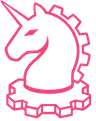

# Robo Scout



Robo Scout is the Robo Knights film desk for **FIRST Tech Challenge BIOBUZZ**. Import a match, mark the robots, and compare their Pollen and Nectar shots, successful Hive entries, final pieces, and reviewed penalty calls. Select an event to jump to the footage that supports it.

## Install on an Apple Silicon Mac

Robo Scout uses Python 3.12, Node.js, and FFmpeg. On a Mac with Homebrew and Git installed, run:

```bash
brew install node uv ffmpeg
git clone https://github.com/Yatishgrandhe/robo-scout.git
cd robo-scout
./setup.sh
```

Setup creates an isolated Python environment, installs the locked frontend dependencies, builds the website, downloads the public model weights, and generates a short synthetic practice clip. Allow time for the first model downloads. A Mac with 16 GB of memory can run the local analysis.

## Start the server

From the repository folder, run:

```bash
bash "./Open Robo Scout.command"
```

You can also double-click **Open Robo Scout.command** in Finder. The launcher opens [Robo Scout](http://127.0.0.1:8765). Keep its Terminal window open during analysis. Press **Control–C** there to stop the server.

The website build and Python runtime live under `~/Library/Application Support/Pitlane` so macOS can serve the frontend without relying on iCloud copies. The launcher binds to this Mac’s loopback address. Imported videos, review decisions, training data, and custom weights are excluded from Git.

## Review a match

1. **Import video** and choose a continuous view that shows the field and Hive openings.
2. **Calibrate & analyze**. Draw a tight box around each robot on a clear frame and enter its team number and alliance. Add keyframes wherever a robot is obscured or its track drifts.
3. Check the Hive Cell zones and match clock. Mark each visible Flower separately from the top ring to the middle ring. Use **Follow camera motion** for handheld clips. A fixed camera gives the best view of a ball crossing the opening.
4. Select a team, then filter the event log for **Launches**, **Hive entries**, **Retained pieces**, **Nectar pickups**, or **Penalties**. Review uncertain events and use **Watch release** when a linked shot is available.
5. Open **Defense review** for a robot’s performance comment, scoring highlight, and pressure clips. Use **Add comment** to save a note for the selected robot at the playhead. Find saved notes under **Comments** in the event log.
6. Use **Teamwork fluidity** to compare each alliance’s scoring rhythm and watch clips where teammates took turns at the Hive. The estimate weights the split of confirmed Hive entries and quick switches between teammates equally. A switch is quick when consecutive entries by different robots are within 12 seconds.
7. Use **Library** to create folders, rename reviews, and move recordings. **Export review** saves the event log, calibration, scouting observations, and available defense estimates as JSON.

| Count | What it measures |
| --- | --- |
| Shot | A piece launched by the selected robot, including misses |
| Entered Hive | A piece that successfully enters the Cell during play, including pieces spilled by a later Hive Tip |
| Final | Pieces still scoring after play ends |
| Penalty points | Reviewed referee calls that award points to the other alliance |

Machine suggestions require review. A dash means no count has been verified. Camera cuts, small balls, overlapping volleys, and occlusion can hide a release or an entry. Defense time is the percentage of jointly visible play classified as direct pressure or lane defense. Lane time outside direct pressure counts at half weight. Use the clips to check what happened, including whether apparent lane defense was intentional.

Flower analysis uses projected partial overlap with the marked scoring volume. It estimates ownership from the highest visible Nectar and the bottom bonus from the lowest visible Nectar. For robot attribution, the tracker looks for a supported top entry. Early Nectar is a separate G410 candidate and can still appear in the final contents. A single camera can obscure depth and tightly stacked pieces. Review those candidates using §10.5.2, G410, and G418 in the [FIRST BIOBUZZ competition manual](https://ftc-resources.firstinspires.org/ftc/archive/2027/game/manual).

## Models and optional training

Robo Scout combines YOLO detections, a SAM 2.1 seed mask, NanoTrack, and OpenCV motion tracking. A separate video-rate pass follows launches. The Hive entry pass looks for a descent into a marked Cell, visible deceleration, and a unique link to a shot. A match-specific Pollen detector can provide more detailed Hive crops.

Use labeled frames from multiple matches and camera angles for training. Save entire matches for validation so adjacent frames do not leak between sets. Annotations use the YOLO box format. The standard detector accepts `pollen`, `red_nectar`, `blue_nectar`, and `robot` labels.

```bash
runtime="$HOME/Library/Application Support/Pitlane/runtime"
PYTORCH_ENABLE_MPS_FALLBACK=1 "$runtime/bin/python" -m scripts.train /absolute/path/dataset.yaml
```

The result is `models/ftc.pt`, selectable under **Ball detector**. For a fixed-camera Hive crop dataset, use the class name `pollen` and train with `--name hive-pollen --size 320`. To use that optional checkpoint for one recording, place it at `data/matches/<recording-id>/hive-pollen.pt`.

For Flowers, label tight crops of the tube and its opening with `pollen`, `red_nectar`, and `blue_nectar`. Include empty crops, stacked balls, and partially occluded pieces. Reserve whole recordings for validation. Train with `--name flower-crop --size 320 --tight-crops`. When `models/flower-crop.pt` is present, Robo Scout uses it on marked Flowers to supplement color and geometry proposals. Confirm the resulting Flower evidence from the footage.

For shooting, train from confirmed and dismissed trajectories with `python -m scripts.train_shots /absolute/path/shot-labels.json`. Use the same isolated Python runtime as above. Each JSON row supplies a recording `group`, binary `label`, and `samples` as `[time, x, y]` triples with normalized coordinates. The script reports performance with each recording held out in turn. The resulting `models/shot-motion.json` enables **Prioritized shots** in the event log. Review decisions still determine the verified shot count.

The repository contains the app and training tools. Footage and match-specific checkpoints stay on the Mac that produced them.

## Check the app locally

After setup, run the Hive-entry tests from the repository folder.

```bash
"$HOME/Library/Application Support/Pitlane/runtime/bin/python" -m unittest discover -s tests
```

## Troubleshooting

- If Terminal stops at the first space in a path, wrap the full path in double quotes.
- If a dependency is missing, rerun the Homebrew command and then `./setup.sh`.
- If a tab shows unstyled content after a build, reload it. The launcher serves the local build in Application Support.
- If tracking loses a robot, add a keyframe where the team number or chassis is visible and rerun analysis.
